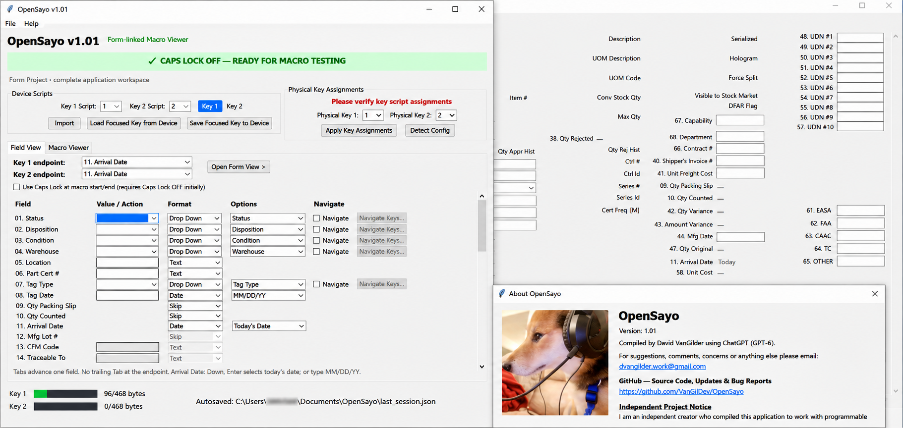
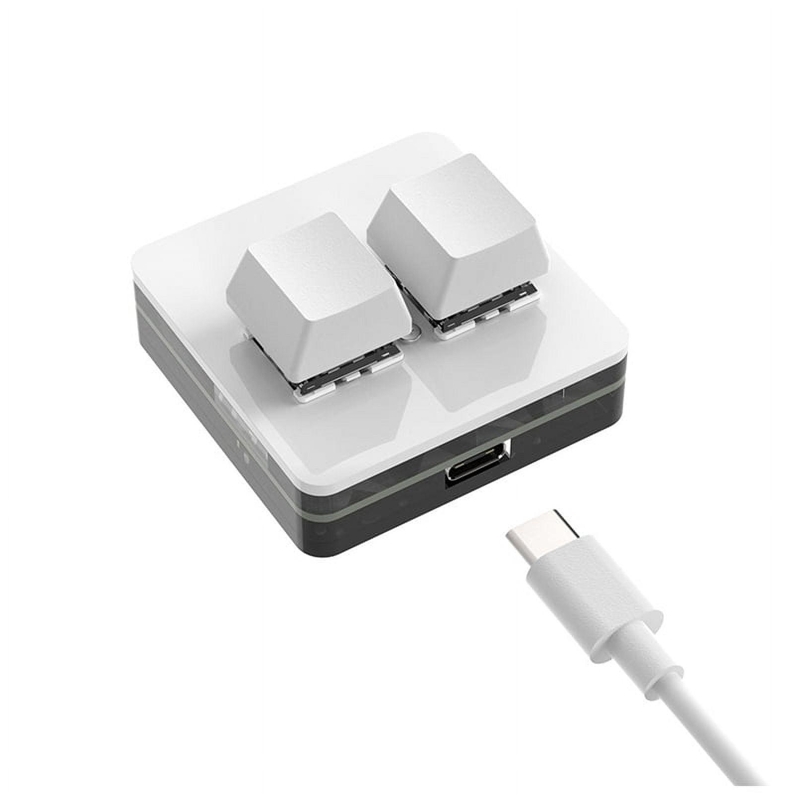

  

<h1 align="center">OpenSayo — Offline Programmable Keypad Macro Editor</h1>

  Free • Open Source • Offline • Windows

## Application Preview

  

---

## About OpenSayo

**OpenSayo** is a free, open-source Windows application designed to create, edit, organize, preview, and program keyboard macros for compatible SayoDevice programmable keypads.

Developed as an alternative to browser-based programming tools, OpenSayo provides a dedicated desktop environment for configuring programmable keypads without requiring an active internet connection.

The goal is simple: **make programmable keypad macros easier to create, understand, modify, and deploy while keeping the software transparent, portable, and accessible.**

## What OpenSayo Does

OpenSayo allows users to configure programmable keypad buttons to execute predefined sequences of keyboard actions.

These sequences can include typed text, keyboard shortcuts, navigation commands, and timed delays. Instead of manually repeating the same keyboard operations, users can program their keypad to perform those actions with a single button press.

Once a compatible keypad has been successfully programmed, its stored macros can operate independently of OpenSayo. This allows users to configure their hardware on one computer and use it on another without installing OpenSayo on the destination system.

## Main Features

### Visual, Form-Based Macro Editing

OpenSayo includes a form-linked macro editor that organizes keyboard actions into individual fields.

Rather than requiring users to work exclusively with raw keyboard commands, the application presents editable values and configurable actions in a structured interface.

Users can configure:

- **Flexible Field Input & Configuration** — Customize text entries, dropdown selections, date fields, and other field-specific actions.
- **Skippable Fields** — Bypass fields that do not require automated input.
- **Keyboard Navigation** — Customize navigation commands and movement between fields.
- **Macro Endpoints & Execution Order** — Control where each macro ends and how its actions execute.
- **Fully Customizable Form View Layout & Preview** — Arrange, reposition, and customize form fields to visually represent your workflow, with the ability to save and load layouts.

This approach is particularly useful for repetitive data-entry workflows involving multiple fields, allowing users to build macros while maintaining a clear visual representation of their workflow.

### Macro Viewer and Editing

OpenSayo also provides a macro viewer for examining the underlying keyboard instructions.

This allows users to inspect and adjust macro sequences, including typed text, navigation keys, and timing operations.

The combination of structured field editing and direct macro inspection gives users greater control over their programmed actions.

### Dual-Key Device Management

OpenSayo supports independent macro configuration for the two physical buttons on the tested SayoDevice Mini 2-Key keypad.

Users can:

- Configure separate macros for each key.
- Select the script assigned to each physical button.
- Read supported script data from the connected device.
- Write edited scripts to the device.
- Review and apply physical key assignments.

Device configuration tools are integrated into the main application window.

### Macro Size Monitoring

Programmable keypads have limited onboard storage.

OpenSayo displays the compiled size of each macro using a visual capacity indicator.

For the currently supported device configuration, the application monitors a **468-byte capacity per key**.

This helps users identify oversized macros before attempting to write them to their hardware.

### Form Preview

OpenSayo includes a separate Form View that visually represents the fields associated with a macro.

The layout is fully customizable, allowing users to arrange and reposition fields to match their workflow.

Users can save and load layouts, making it easier to reuse or share customized form arrangements.

This provides a visual reference for understanding how the programmed keyboard sequence corresponds to a larger data-entry form.

### Save, Load, and Reuse Projects

Users can save their macro configurations as OpenSayo project files (`.osayo`) and reload them for future editing.

The application also supports configurable form layouts and local session persistence.

This makes it possible to maintain multiple macro configurations without rebuilding them from scratch.

### Offline Operation

OpenSayo is designed to run locally on Windows.

An internet connection is not required for normal macro editing or device programming.

The application does not depend on the manufacturer's website to perform its supported programming operations.

### Open Source and IT Review

OpenSayo is distributed under the MIT License.

Source code and supporting build documentation are available for inspection, modification, and independent compilation.

This is particularly useful in environments where software must be reviewed before installation or use.

OpenSayo is an independent community project and is not affiliated with or endorsed by SayoDevice or its manufacturer.

---

## Supported Hardware

**SayoDevice Mini 2-Key Programmable USB Keypad**

This is the device currently used for OpenSayo development and testing.

[View the tested keypad on Amazon](https://www.amazon.com/dp/B0GR99WVWR)

**Compatibility:** Other SayoDevice models have not yet been verified.

While support for additional devices may be possible, access to the specific hardware is needed to test its communication protocol, verify compatibility, and implement support.

A similarly priced programmable keypad from another manufacturer was also tested during development, but it supported substantially fewer characters and commands than the SayoDevice used for OpenSayo.

If you would like support for another device, feel free to submit a feature request through GitHub Issues.

Hardware contributions and sponsorships may help fund future device testing, but compatibility with any particular device cannot be guaranteed.

---

## Typical Uses

OpenSayo may be useful for:

- Repetitive data-entry tasks.
- Multi-field form completion.
- Frequently used text sequences.
- Keyboard navigation automation.
- Application-specific keyboard shortcuts.
- Workflows requiring consistent, repeatable keystroke sequences.

Users should review generated macros and confirm their behavior before relying on them in important workflows.

## Downloads and Installation

Download the latest packaged Windows release from:

**[OpenSayo Releases](https://github.com/VanGilDev/OpenSayo/releases)**

The release packages include:

- **Windows x64 Package** — Packaged application for Windows users.
- **Source & IT Package** — Source code and supporting materials for inspection and independent compilation.

Extract the Windows package and launch `OpenSayo.exe`.

For source compilation, review the included build instructions and supporting documentation.

## Source Code, Bug Reports, and Suggestions

**GitHub Repository:**  
https://github.com/VanGilDev/OpenSayo

**Releases:**  
https://github.com/VanGilDev/OpenSayo/releases

**Bug Reports and Feature Requests:**  
https://github.com/VanGilDev/OpenSayo/issues

**Community Discussions:**  
https://github.com/VanGilDev/OpenSayo/discussions

Feedback, suggestions, bug reports, and contributions are welcome.

When reporting an issue, please include the OpenSayo version, Windows version, keypad model, and steps needed to reproduce the problem.

Do not include passwords, confidential information, or sensitive macro contents in public reports.

## License

OpenSayo is released under the **MIT License**.

See the [LICENSE](LICENSE) file for details.

---

  <strong>OpenSayo — Program your keypad, not your patience.</strong> 🐾

*OpenSayo is an independent project and is not affiliated with or endorsed by SayoDevice or the seller.*
